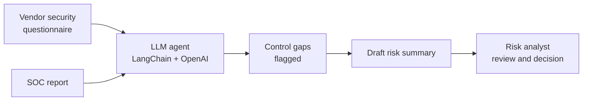

<h1 align="center">Agentic AI Third-Party Risk Management Assistant</h1>

  <b>An LLM agent that reviews vendor security questionnaires and SOC reports, flags control gaps,
  and drafts risk summaries</b> 
  Built for <b>Sony</b> during my internship, May – August 2026

  
  
  
  
  

> **About this repository.** This is a case study. The assistant was built inside Sony's environment and its code, data and outputs are proprietary, so none of them are published here. This page describes the problem, the approach and the outcome.

---

## Result

**~70% reduction in review effort** across simulated vendor assessments, compared with reviewing the same material manually.

## The problem

Third-party risk management (TPRM) teams assess every vendor that handles company data or supports critical services. Each assessment means reading long security questionnaires and independent audit reports such as SOC reports, checking the vendor's answers and controls against what the company requires, and writing up the risks found.

That work is slow, repetitive and hard to keep consistent across analysts and vendors, and the volume grows with every new supplier.

## What I built

An agentic assistant that takes on the first pass of a vendor security review:

1. **Reads the vendor's evidence.** Security questionnaire responses and SOC reports.
2. **Flags control gaps.** Identifies where the vendor's answers or reported controls fall short of what's expected, or where evidence is missing.
3. **Drafts a risk summary.** Writes a structured summary of the gaps and the risks they create, ready for a risk analyst to review.

## Tech stack

**Python** · **LangChain** · **OpenAI APIs**

## What this project demonstrates

- Applying agentic AI to a real governance, risk and compliance workflow, not a toy problem.
- Working with long, unstructured compliance documents (questionnaires and audit reports) and turning them into structured findings.
- Control-gap analysis and risk communication: the output is written for the people who make vendor risk decisions.
- Measuring impact: the assistant was evaluated against manual review effort on simulated assessments.

## Confidentiality

Built during my internship at Sony. Source code, prompts, internal standards, vendor names and assessment data remain Sony's property and are not shared here. Happy to discuss the approach in more depth in conversation.

## Author

**[@aishwaryapurohit15](https://github.com/aishwaryapurohit15)**
